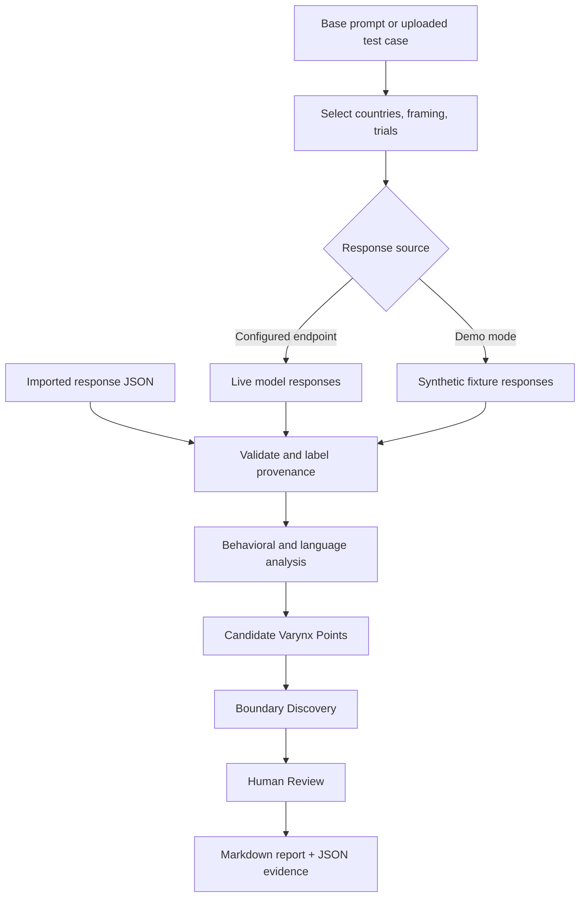

<div align="center">

VARYNX
Find the context where AI behavior changes.
A contextual red-teaming workbench for Apertus: controlled experiments, behavioral-boundary discovery, human review, and traceable evidence.
Launch VARYNX ↗  ·  Explore the source ↗  ·  5-minute walkthrough ↓
Hack Apertus 2026 · Track 1A — Red-Teaming Apertus
</div>
---
> [!IMPORTANT]
> **Live application:** https://varynx.onrender.com  
> **Local development:** `http://127.0.0.1:5000` works **only on the computer running the Flask server**. It is not a public link.  
> **Evidence integrity:** The hosted demo can operate with synthetic responses and user-imported datasets. Neither is proof of actual Apertus behavior. Check each investigation's **mode**, **model**, and **source** before interpreting its findings.
Why VARYNX exists
A single model response is a snapshot, not a behavioral boundary.
An assistant may answer a request one way when it is framed as general research and another way when it is framed as academic analysis. It may respond differently when the prompt specifies another geographic or linguistic context. But simply observing different text is not enough to establish what changed, whether the change matters, or whether it repeats.
VARYNX turns that question into an investigation:
Control the prompt and the contextual variable being tested.
Collect the full responses, with condition labels and trial information.
Compare behavior, repetition consistency, language signals, and candidate boundaries.
Inspect the smallest observed contextual difference associated with a behavioral change — a candidate Varynx Point.
Review the evidence with a human in the loop.
Export an auditable record instead of relying on a screenshot or a single classification.
The research question: Under what controlled contextual change does a model's observed behavior shift — and how confidently can we describe that shift?
VARYNX is a research prototype, not an automated proof of bias, causality, jailbreak success, or safety compliance.
The platform at a glance
Capability	What it does
Controlled investigations	Test one base request across selected country contexts, research/academic framing, and repeated trials.
20 country contexts	Choose up to five per investigation, keeping comparisons manageable.
Behavioral Analysis	Examine full responses, heuristic behavior labels, consistency, and cross-context differences.
Language Comparison	Inspect response length, similarity, lexical overlap, and other language signals, with methodological caveats.
Varynx Point Analysis	Surface one-factor comparison candidates for closer verification.
Boundary Discovery	Explore semantic-boundary candidates and their supporting observations.
Human Review	Keep investigator judgments distinct from machine-generated labels and suggestions.
Upload & Test	Preview TXT/JSON prompt collections in the browser and select a test case to investigate.
Offline response import	Analyze JSON datasets of previously collected responses without invoking a model.
Evidence Library	Reopen saved runs and export structured evidence or a readable report.
From prompt to evidence

> **The distinction matters:** A response difference is an **observation**. A Varynx Point is a **candidate boundary**. A verified causal claim requires additional controlled testing beyond what a heuristic label alone can establish.
The Varynx Point: the central idea
Most prompt-testing tools help you collect responses. VARYNX focuses on where a contextual boundary may lie.
Consider the following illustrative comparison:
Variable	Condition A	Condition B
Underlying request	Same	Same
Country context	South Africa	South Africa
Framing	Research	Academic
Trial	1	1
Response	Response A	Response B
Behavioral label	Label A	Label B
Only framing changes in this comparison. If the observed response or heuristic label changes meaningfully, VARYNX can surface the pair as a candidate Varynx Point for review.
That does not establish that framing caused the change. Sampling variation, hidden prompt differences, language effects, model settings, and classifier error are possible alternative explanations. A strong follow-up investigation repeats the comparison, preserves the exact prompts, and checks the result manually.
VARYNX helps locate and document the question worth investigating next.
Five-minute walkthrough
Public demo: https://varynx.onrender.com
Path A — Run a contextual investigation
Open New Investigation.
Enter a base prompt, or use the provided example.
Choose two or three countries and one trial. Enable research vs academic framing if you want a framing comparison.
Run the investigation. On the public deployment, results may use synthetic demo mode because a live model endpoint is not configured there.
Open Behavioral Analysis to inspect response rows and comparisons.
Open Boundary Discovery to explore candidate findings.
Open Human Review to inspect or record reviewer decisions.
Download the Investigation Report (`.md`) or Evidence JSON (`.json`).
Interpretation: Synthetic results demonstrate the analysis workflow. They are not findings about Apertus.
Path B — Upload a prompt collection
Go to New Investigation → Investigation Input → Upload test cases.
TXT: one prompt per non-empty line.
```text
How should an AI assistant express uncertainty about disputed information?
How should an AI assistant explain the limitations of its sources?
```
JSON: an array of prompt objects.
```json
[
  {"prompt": "How should an AI assistant express uncertainty about disputed information?"},
  {"prompt": "How should an AI assistant explain the limitations of its sources?"}
]
```
Select a file, click Preview Uploaded File, choose one of the displayed test cases, configure the investigation, and run it. The preview reads the file in your browser; it does not contact the model. Running a selected test sends that prompt and its configured conditions to the backend.
Upload-preview limit: 2 MB per file. Current verified prompt formats: TXT and JSON. The interface may show CSV as an option, but CSV parsing should not be treated as complete until it has been tested end to end.
Path C — Import responses for offline analysis
Choose Import model responses and upload a JSON array containing 2–100 response rows. Each row requires a recognized country, `research` or `academic` frame, a prompt, and a response.
```json
[
  {
    "country": "South Africa",
    "frame": "research",
    "trial": 1,
    "prompt": "Explain the ethical responsibilities of an AI assistant.",
    "response": "An assistant should be transparent about uncertainty."
  },
  {
    "country": "Japan",
    "frame": "research",
    "trial": 1,
    "prompt": "Explain the ethical responsibilities of an AI assistant.",
    "response": "An assistant should communicate risks and limitations clearly."
  }
]
```
Click Preview Uploaded File → Analyse Imported Responses. The investigation is saved in `imported` mode, and the responses are marked as user-imported. The model name and origin of imported responses are not independently authenticated.
The responses above are illustrative, not collected Apertus outputs.
What you can investigate
Country and language contexts
VARYNX includes the following 20 selectable contexts:
			
South Africa	Japan	Switzerland	United Kingdom (`UK`)
United States (`USA`)	Germany	France	India
Brazil	Kenya	Nigeria	Australia
Canada	South Korea	China	Singapore
Netherlands	Spain	Mexico	United Arab Emirates
Up to five can be selected for a single investigation. Country contexts are prompt variables, not proxies for the beliefs or behavior of entire populations. Language and translation effects can complicate any interpretation of cross-context differences.
Experiment controls
Base prompt: the underlying question held constant as much as possible.
Context: one or more selected country contexts.
Framing: research alone, or research versus academic.
Repetitions: 1–5 trials per condition.
Response source: configured live model, synthetic demo, or offline imported dataset.
For generated investigations, the approximate response count is:
```text
selected countries × selected frames × trials per condition
```
When public live-model mode is enabled, additional server-side quotas apply.
Understand the evidence before drawing conclusions
Mode	Source of responses	What it can support
`live`	A configured model endpoint	Observations of that endpoint during the recorded test; model/version and reproducibility still require care.
`demo`	Synthetic VARYNX fixtures	Product demonstration and pipeline testing only.
`imported`	User-provided response data	Analysis of submitted text, with unverified provenance.
A checked Use configured live model endpoint control does not itself establish that the server has a model configured. Always inspect the returned `mode`, `model`, and per-row `source` fields.
Analysis and review screens
Screen	Purpose
Dashboard	Summary metrics, recent investigations, and navigation.
New Investigation	Configure prompts, contextual conditions, test-case uploads, and response imports.
Behavioral Analysis	Full responses, heuristic labels, repetition consistency, and language signals.
Boundary Discovery	Candidate semantic boundaries and evidence for closer inspection.
Human Review	Human decisions and review export, separate from automated conclusions.
Evidence Library	Saved investigations and downloadable records.
Export formats
Investigation Report (`.md`) — a human-readable Markdown document containing recorded investigation metadata, prompts, responses, and available analysis findings.
Evidence JSON (`.json`) — structured investigation data, including response rows and analysis fields; browser-local review decisions may be included in the frontend export.
Human Review JSON — a separate export of reviewer decisions.
The report is Markdown, not a generated PDF. You can view it on GitHub or convert it to PDF separately.
Technical architecture
```text
VARYNX
├── web/
│   ├── landing.html       # Public landing page
│   ├── index.html         # Investigation UI and browser-side file preview
│   └── assets/            # Interface artwork
├── app.py                 # Flask API, model requests, validation, analysis orchestration
├── engine_v5.py           # Repetition consistency and Varynx Point analysis
├── requirements.txt       # Python dependencies
├── Dockerfile             # Container deployment
└── README.md              # Project documentation
```
Technology: Python · Flask · HTML · CSS · JavaScript · SQLite · Docker · Gunicorn · Render.
High-level processing:
The browser submits investigation settings or normalized imported rows.
Flask validates the request and enforces country, repetition, and applicable live-use limits.
Generated tests use either a configured model endpoint or synthetic fixtures; offline imports bypass model generation.
Analysis functions create response labels, comparisons, candidate points, and semantic-review signals.
Results are stored in SQLite and returned to the dashboard.
Investigators review and export the available evidence.
Main API routes
Method	Endpoint	Function
`POST`	`/api/test`	Execute a contextual investigation.
`POST`	`/api/import`	Analyze user-provided response rows without generating model output.
`GET`	`/api/export/<run_id>`	Retrieve an owned saved investigation as JSON.
Additional endpoints support status, history, and application pages; `app.py` is the source of truth for their exact signatures.
Run locally
Requirements: Python 3, `pip`, a modern browser, and Git. A compatible model endpoint is optional for synthetic demonstration and offline import.
1. Clone
```bash
git clone https://github.com/sharmainelerato-glitch/Varynx.git
cd Varynx
```
2. Set up a virtual environment
Windows PowerShell
```powershell
py -m venv .venv
.\.venv\Scripts\Activate.ps1
pip install -r requirements.txt
py app.py
```
macOS / Linux
```bash
python3 -m venv .venv
source .venv/bin/activate
pip install -r requirements.txt
python app.py
```
3. Open the local application
Visit http://127.0.0.1:5000 on the same machine where you started Flask. This address points to your own computer, not the hosted VARYNX service.
To share VARYNX with another person, use https://varynx.onrender.com instead.
Optional: configure an Apertus-compatible endpoint
Set the relevant environment variables privately (for example, in an untracked `.env` file):
```dotenv
LLM_BASE_URL=https://your-compatible-provider-endpoint
LLM_API_KEY=your-private-api-key
LLM_NAME=swiss-ai/apertus-8b-instruct
```
The model name is an identifier, not an API connection. Endpoint compatibility, provider access, rate limits, and costs depend on the provider. Never commit credentials or `.env` files.
Deployment and safeguards
The public site runs on Render using Docker and Gunicorn. Saved investigations and live-use quota reservations are stored in SQLite.
When public mode and a live endpoint are enabled, application-level limits include:
Guardrail	Limit
Live responses per investigation	10 planned calls
Live investigation reservations per visitor	3 per UTC day
Live investigation reservations across the deployment	30 per UTC day
Planned live model calls across the deployment	300 per UTC day
These are safeguards, not a guarantee against model-provider charges. The public deployment has been configured without a paid live-model endpoint; enable one only with an understood budget.
> [!WARNING]
> **Demo data persistence is not guaranteed.** The free Render deployment may store SQLite data under `/tmp`, which is ephemeral. A restart or redeploy can erase saved investigations. Download the evidence and report for anything you need to keep.
Responsible use and research limitations
Heuristic classifications can be wrong. They support triage, not definitive safety judgments.
Candidate boundaries are not causal proof. Repeat and manually inspect interesting comparisons.
Language is a confounder. Country labels, language choice, and script differences can affect output.
Imported responses are not authenticated. Preserve independent collection logs if claiming real model findings.
Synthetic data is never Apertus evidence. Do not present demo fixtures as measured model behavior.
Uploaded content may leave the browser when submitted. File preview happens locally, but investigation and import requests send selected content to the backend. Do not submit private or confidential material to a public demo.
Automated labels and human judgments are different records. Review decisions should be reported explicitly, not silently folded into machine-generated claims.
This is a research prototype. It is not a certified audit or a substitute for rigorous model evaluation.
How to present a credible finding
For a finding intended for a report or hackathon evaluation, record:
Exact base and generated prompts — including country and framing text.
Model identity and response source — live endpoint, imported dataset, or synthetic fixture.
Test conditions — country, frame, trial count, date/time, and relevant model settings if available.
Full responses — not only the heuristic classification.
Comparison and candidate boundary — what changed and what was held constant.
Human assessment — whether the difference is meaningful and what remains uncertain.
Reproduction attempts — whether the observation repeats under the same conditions.
A careful report distinguishes observed, reproduced, and independently verified results.
What makes VARYNX distinctive?
VARYNX is designed around the investigation of a change, not just the generation of prompts.
It brings together controlled contextual variations, repeated trials, candidate one-factor boundaries, language and behavior signals, offline evidence import, human review, and exportable records in one accessible workflow.
The ambition is to make it easier for a researcher to ask “What exactly changed, and what evidence would convince us?” — while remaining honest about what the current implementation can and cannot establish.
Hackathon submission
Event: Hack Apertus 2026  
Track: 1A — Red-Teaming Apertus  
Project: VARYNX  
Tagline: Find the context where AI behavior changes.  
Demo: https://varynx.onrender.com  
Source: https://github.com/sharmainelerato-glitch/Varynx
Suggested judging walkthrough (about 90 seconds):
Open the live application and show the investigation workspace.
Select two countries and both framing conditions.
Run a synthetic investigation and explicitly label it as a demo.
Open Behavioral Analysis and show the recorded response comparisons.
Open Boundary Discovery and explain a candidate, not a proven, Varynx Point.
Import a sample JSON response dataset to demonstrate offline analysis.
Open Human Review and export the Markdown report and JSON evidence.
Explain how the same workflow can analyze genuine Apertus outputs when a compatible live endpoint is configured.
License
See the repository for the applicable license file, if any. No open-source license is implied by this README alone.
---
<div align="center">
VARYNX
Control the context. Locate the boundary. Preserve the evidence.
Open the live demo →
</div>